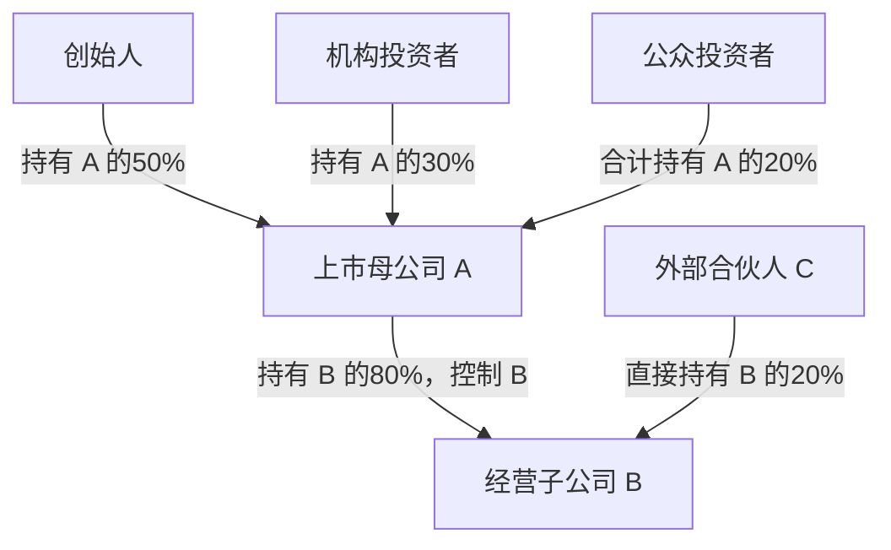

# 收入、利润与现金流：一份简化季度财报案例

> 整理日期：2026-09-23  
> 单位：金额为亿美元，股数另标；每股收益、股价及每股分红为美元／股。全部数字为教学假设，不对应真实公司。  
> 用途：理解利润表、现金流量表和资产负债表如何衔接，以及投资出售、罚款、分红和回购分别体现在哪里。

> 标记：指标名称后的 \* 表示核心指标，建议优先阅读。

## Summary｜核心指标汇总

**本季度收入 100、合并净利润 43，其中归母净利润 34.4、少数股东损益 8.6；自由现金流 7。实际对外现金分红合计 55.7，其中母公司股东获得 44.56、子公司少数股东获得 11.14。** 另有出售投资回款 50，因此分红后现金仍较期初增加 1.3，达到 **501.3**。长期负债 **100** 本季度不偿还。

金额单位为**亿美元**；利润和现金流为**单季度**，资产负债为**季度末**。本例母公司为**已上市的 A 公司**，持有唯一经营子公司 **B 公司 80%**，另外 **20%** 由少数股东持有；三张报表采用集团合并口径，子公司收入、资产、负债和现金流均按 **100%** 纳入。本案例暂不考虑所得税、借款利息等项目，正常化指标为本文分析口径。

| 类别 | 核心指标 | 本期结果 | 口径／说明 |
|---|---|---:|---|
| 收入 | **主营收入／主营实际到账** \* | **100／90** | 当期收入中 10 尚未收回 |
| 盈利 | **营业利润／营业利润率** \* | **18／18.00%** | 已扣本季度罚款 20 |
| 盈利 | **正常化主营利润／利润率** \* | **38／38.00%** | 加回一次性罚款；不含利息和投资出售收益，保留工资与折旧 |
| 盈利 | **合并净利润／合并净利率** \* | **43／43.00%** | 包含利息 5、投资出售收益 20 及罚款支出 20 |
| 盈利 | **归母净利润／少数股东损益** \* | **34.4／8.6** | 合并净利润 43 按 80%／20% 分配，不是额外经营费用 |
| 增长 | **收入、利润与 FCF 同比／环比** \* | **待补历史数据** | 缺去年同季度及上季度数据，不能据此判断增长 |
| 现金流 | **经营现金流** \* | **15** | 相当于合并净利润的 34.88% |
| 现金流 | **资本开支／收入占比** \* | **8／8.00%** | 本例全部为扩张设备投入 |
| 现金流 | **自由现金流／收入占比** \* | **7／7.00%** | 经营现金流 15－资本开支 8；不含投资出售回款 50 |
| 分红 | **现金分红（理论最大值，集团合计）** \* | **557** | 含母公司股东与少数股东两部分；仅作现金上限，不是法定可分配额 |
| 分红 | **实际对外现金分红合计／股票回购** \* | **55.7／0** | 合计分红按现金上限 557 的 10% 计算 |
| 分红 | **母公司股东分红／少数股东分红** \* | **44.56／11.14** | 分别为 55.7×80%、55.7×20%；内部转款不重复计入 |
| 分红 | **分红支付率／FCF 对分红覆盖率（合并口径）** \* | **129.53%／12.57%** | 合计分红 55.7÷合并净利润 43；集团 FCF 7÷合计分红 55.7 |
| 财务状况 | **期末现金／较期初增加** \* | **501.3／1.3** | 现金余额较期初增长 0.26% |
| 财务状况 | **期末应收账款／投资资产** \* | **50／270** | 均非已经到账的现金，投资为账面价值 |
| 财务状况 | **期末资产／负债／股东权益总额** \* | **827.3／100／727.3** | 权益总额包含归母权益和少数股东权益 |
| 财务状况 | **期末归母权益／少数股东权益** \* | **581.84／145.46** | 权益总额 727.3 按本例 80%／20% 拆分 |
| 财务状况 | **资产负债率／净现金** \* | **12.09%／401.3** | 净现金＝现金 501.3－有息借款 100，未扣经营现金储备 |
| 资本回报 | **单季度归母 ROE／集团 ROA** \* | **5.86%／5.16%** | 归母利润÷平均归母权益；合并净利润÷平均总资产，均未年化 |
| 上市估值 | **普通 PE** \* | **10 倍** | 股价÷年化归母EPS；本例设定 |
| 上市估值 | **估值用年化归母净利润** \* | **137.6** | 本季归母利润34.4×4，仅为年化演示，不是实际TTM |
| 上市估值 | **上市公司总市值** \* | **1,376** | 年化归母利润137.6×PE10；不包含子公司少数股东直接持有的权益 |
| 股本 | **普通股总股数** | **10 亿股** | 既有股数，全季不变；无潜在稀释 |
| 每股指标 | **示例股价** \* | **137.60 美元／股** | 总市值1,376亿美元÷10亿股 |
| 每股指标 | **本季EPS／估值用年化EPS** \* | **3.44／13.76 美元／股** | 分别为34.4÷10、137.6÷10；基本与稀释EPS相同 |
| 上市估值 | **市净率 PB／每股归母净资产** | **2.36 倍／58.184 美元** | 市值÷归母权益581.84；每股净资产＝581.84÷10 |
| 上市估值 | **年化盈利收益率** | **10.00%** | 年化归母利润137.6÷市值1,376＝1÷PE；不是股息率 |
| 每股分红 | **本季每股分红／本季分红占市值** | **4.456 美元／3.24%** | 母公司股东分红44.56÷10亿股、44.56÷1,376；未年化 |

**阅读重点：**正常化主营利润 38、合并净利润 43、归母净利润 34.4 和集团自由现金流 7 是不同口径。实际分红超过当期利润和 FCF，本季度有投资变现回款补充资金；不能据此认定未来每季度都能维持相同分红。另设上市公司 A 的普通 PE 为 **10 倍**。按本季归母净利润 34.4 简单年化为 137.6，示例市值为 **1,376**；这不是已披露全年或 TTM 利润。股权结构见第一章，EPS、股价及估值计算见第五章。毛利率和历史增长仍缺数据。

## 一、案例假设

| 项目 | 假设 |
|---|---|
| 集团与持股结构 | 已上市的 A 公司期初即持有唯一经营子公司 B 的80%，外部合伙人 C 直接持有 B 的20%且不持有 A，全季比例不变；全部对外业务、外部投资、资产和负债均在该子公司；母公司仅持有该子公司股权，无其他业务或费用；无商誉、购买价差、优先分配或其他综合收益 |
| 合并处理 | 母公司对子公司的股权投资与相应子公司权益在合并时抵销；子公司持有的外部投资资产 300 另行保留，不是该项内部持股 |
| 上市公司股东构成 | A 的创始人持股50%、机构持股30%、公众投资者合计持股20%；三者共同拥有上市公司A的100%股权，均属于母公司股东 |
| 股本与上市假设 | A 已有普通股10亿股，整季股数不变，无优先股、期权、可转债等潜在稀释；不发生IPO、增发或股份交易，所以不增加本例现金或股东权益 |
| PE与期间口径 | 普通PE假设为10倍；仅为展示算式，以本季度归母净利润34.4×4＝137.6作为年化分母，不声称已知全年、TTM或未来利润；不年化分红及现金流 |
| 季度初现金 | 500，全部可用，与投资资产单独列示 |
| 季度初应收账款 | 40，本季度没有收回，也没有坏账 |
| 季度初投资资产 | 账面价值 300，属于长期股权投资，不是现金 |
| 季度初设备 | 0 |
| 季度初负债 | 100，全部为未到期的长期借款本金，本季度不偿还 |
| 本季度主营收入及收款 | 确认收入 100，实际收到 90，形成新增应收账款 10 |
| 成本费用 | 原料、工资等 60，不含折旧；本季度全部消耗并付清，无存货或应付款变化 |
| 设备投入及折旧 | 本季度支付设备款 8、确认折旧 2；折旧 2 是独立设定的季度费用，不沿用此前“四年折旧”的假设 |
| 利息收入 | 本季度确认并收到 5，不将其解释为年利率 10%；本例将收到的利息归入经营现金流 |
| 投资出售 | 出售股份收到 50，被售部分账面价值 30，确认出售收益 20；剩余投资账面价值 270，不发生其他估值变化 |
| 一次性罚款 | 本季度确认并实际支付 20 |
| 分红与回购 | 长期负债本季度不偿还；子公司现金上限 557，按其 10% 分红 55.7：支付母公司 44.56、少数股东 11.14。母公司当季将收到的 44.56 全额支付给自己的股东，故集团对外分红合计仍为 55.7；股票回购为 0 |
| 其他事项 | 暂不考虑所得税、借款利息、交易费用、受限资金及其他未列项目 |

期初资产总额为 `500＋40＋300＝840`；扣除负债 100，期初股东权益总额为 **740**，其中归母权益为 `740×80%＝592`，少数股东权益为 `740×20%＝148`。这 20% 是子公司外部股东持有的权益，不是把母公司普通股中持股较少的人另算成少数股东。

### 股东构成：谁是上市公司股东，谁是少数股东

**公众投资者即使只持有 A 公司很少的股票，也属于“归属于母公司股东”这一类。财报中的“少数股东”指这里直接持有子公司 B 的外部合伙人 C。** 两个概念按持股所在的公司层级区分，不能只看持股比例大小。



| 股东 | 直接持有哪家公司 | 直接持股比例 | 穿透后对B的经济权益比例 | 本季应占利润，亿美元 |
|---|---|---:|---:|---:|
| 创始人 | 上市公司A | A的50% | 50%×80%＝40% | 34.4×50%＝17.2 |
| 机构投资者 | 上市公司A | A的30% | 30%×80%＝24% | 34.4×30%＝10.32 |
| 公众投资者合计 | 上市公司A | A的20% | 20%×80%＝16% | 34.4×20%＝6.88 |
| **A的全部股东，小计** | **上市公司A** | **A的100%** | **B的80%** | **归母净利润34.4** |
| 外部合伙人C | 子公司B | B的20% | B的20% | **少数股东损益8.6** |
| **最终经济权益合计，不重复加小计** | — | 不跨公司相加 | **B的100%** | **合并净利润43** |

表中的“应占利润”说明经济归属，并非每位股东已收到现金；A的股东通过持有A间接享有B的权益，不是直接持有B的股份。**公众投资者的20%对应利润6.88，C的20%对应利润8.6**，因为前者是A的20%，后者是B的20%。

例如，你持有 **A 的1%**，你属于“归母”这一边，间接享有本例B的 `1%×80%＝0.8%` 经济权益；对应本季归母利润 `34.4×1%＝0.344`，若按本例实际分红，则获得 `44.56×1%＝0.4456`。你不会因为只持股1%就被列入合并报表的少数股东损益8.6。

C持有的是B，不持有A，因此A在股市中的市值不包括C直接持有B的这20%权益。C的期末账面权益145.46也不等于该持股的市场价值；本例未给B或C持股单独定价。

## 二、利润表：本季度赚了多少

| 项目                 | 计算或说明                      |      本季度 |
| ------------------ | -------------------------- | -------: |
| **主营业务收入** \*      | 本季度已完成业务、确认的收入             |  **100** |
| **主营业务实际到账（补充信息）** | 本季度收入中已收到的现金，不重复计入收入       |   **90** |
| 成本费用               | 原料、工资等，不含折旧；全部消耗并付清        |       60 |
| 设备折旧               | 本季度确认的折旧费用                 |        2 |
| 一次性罚款              | 本季度确认并支付，本例列为经营费用          |       20 |
| **营业利润** \*        | 收入 100－成本费用 60－折旧 2－罚款 20  |   **18** |
| 利息收入               | 本季度确认并收到                   |        5 |
| 投资出售收益             | 出售回款 50－被售投资账面价值 30        |       20 |
| **合并净利润** \*       | 营业利润 18＋利息 5＋投资出售收益 20     |   **43** |
| **少数股东损益** \*      | 合并净利润 43×20%，属于子公司其他股东     |  **8.6** |
| **归母净利润** \*       | 合并净利润 43－少数股东损益 8.6＝43×80% | **34.4** |

**43＝34.4＋8.6 是利润归属拆分。**少数股东损益不是成本，不再扣减营业利润或合并净利润；也不等于当季已经支付给少数股东的分红。归母净利润属于母公司股东，但不代表这笔现金已经到账或已分配。

实际到账 90 是补充解释，不是标准利润表的收入加项。收入按确认条件计入，未收到的部分形成应收账款。

罚款即使是一次性的，也要扣减当期报表利润。研究正常盈利能力时，可以另列调整指标，但不能从实际报表或实际现金支出中删掉。本例剔除投资出售收益、加回一次性罚款后，保留利息的利润为 `43－20＋20＝43`，恰好与报表利润相同；两项偶发因素刚好抵消，不表示它们可以忽略。进一步剔除利息后，正常化主营利润为 **38**，均为暂不考虑税费的教学口径。

## 三、现金流量表：现金怎么变化

| 项目                      | 计算或说明                                  |       本季度 |
| ----------------------- | -------------------------------------- | --------: |
| **季度初现金余额**             | 期初已有现金                                 |   **500** |
| 合并净利润                   | 来自利润表，包含归母 34.4 和少数股东损益 8.6            |        43 |
| 设备折旧                    | 非现金费用，推算经营现金流时加回                       |         2 |
| 应收账款增加                  | 主营收入 100－实际到账 90                       |        10 |
| 投资出售收益                  | 已包含在合并净利润中，推算经营现金流时扣除                  |        20 |
| **经营现金流（从利润推算）** \*     | 合并净利润 43＋折旧 2－应收账款增加 10－投资出售收益 20      |    **15** |
| **经营现金流（从收付款计算）** \*    | 主营到账 90＋利息到账 5－付现成本 60－罚款 20           |    **15** |
| 扩张设备投入 \*               | 本季度实际支付的设备款                            |         8 |
| 出售投资股份回款                | 本季度实际收到的全部出售款                          |        50 |
| **投资现金流**               | 出售投资回款 50－设备投入 8                       |    **42** |
| **自由现金流（补充指标）** \*      | 经营现金流 15－设备投入 8                        |     **7** |
| **分红前现金余额**             | 期初现金 500＋自由现金流 7＋出售投资回款 50             |   **557** |
| 偿还借款本金                  | 长期借款本季度未到期，假设不提前偿还                     |         0 |
| **现金分红（理论最大值，集团合计）** \* | 分红前现金 557－本季度偿还本金 0；含双方权益，不是母公司股东独享的上限 |   **557** |
| **现金分红（实际对外分红合计）** \*   | 理论最大值 557×10%                          |  **55.7** |
| 其中：母公司股东现金分红 \*         | 子公司向母公司分配 55.7×80%，母公司再全额向自己的股东支付      |     44.56 |
| 其中：子公司少数股东现金分红 \*       | 子公司直接向外部少数股东分配 55.7×20%                |     11.14 |
| 股票回购                    | 本季度不回购                                 |         0 |
| **融资现金流**               | −偿还本金 0－实际现金分红 55.7－回购 0               | **−55.7** |
| **本季度现金净变化**            | 经营现金流 15＋投资现金流 42＋融资现金流（−55.7）         |   **1.3** |
| **季度末现金余额** \*          | 期初现金 500＋现金净变化 1.3，也等于 557－55.7        | **501.3** |

集团经营现金流从**合并净利润 43**开始计算，不能直接换成归母净利润 34.4；少数股东损益 8.6 是利润归属，不是经营现金支出。子公司向母公司支付 44.56 属于集团内部转款，合并抵销；最终向母公司股东支付 44.56、向少数股东支付 11.14，才构成合并融资现金流流出 55.7。“其中”两行是合计分红的拆分，不重复相加。

两行经营现金流是同一结果的两种算法，不重复相加。自由现金流和分红前现金余额是补充指标，不再单独加进现金净变化。现金分红理论最大值 557 仅用于确定分配基数，真正的现金支出是实际分红 55.7，两者不能重复扣除。

出售长期投资的全部回款归入投资现金流，所以从合并净利润推算经营现金流时，要扣除其中的出售收益。这里从经营现金流中扣除 20，同时在投资现金流列入完整回款 50，没有遗漏或重复计算出售款。[IAS 7 对经营、投资和融资现金流的说明](https://www.ifrs.org/issued-standards/list-of-standards/ias-7-statement-of-cash-flows/)

本例利息 5 已通过合并净利润进入经营现金流，无需再加一次；罚款 20 已实际支付，保留在经营现金流中，不因其一次性而加回。跨公司分析时，还应检查利息和股息的具体现金流分类。

## 四、资产负债表：拥有多少资产、欠多少债

| 项目                 |     季度初 |        季度末 | 计算或说明                                     |
| ------------------ | ------: | ---------: | ----------------------------------------- |
| 现金余额 \*            |     500 |      501.3 | 期初现金 500＋经营现金流 15＋投资现金流 42－实际现金分红 55.7    |
| **应收账款总额** \*      |  **40** |     **50** | 期初 40＋本季度新增 10                            |
| **投资资产账面价值** \*    | **300** |    **270** | 出售其中账面价值 30 的股份，其余投资账面价值不变                |
| 设备原值               |       0 |          8 | 本季度购入设备                                   |
| 累计折旧               |       0 |          2 | 计算设备净值时扣除                                 |
| **设备净值**           |   **0** |      **6** | 设备原值 8－累计折旧 2                             |
| **资产总额** \*        | **840** |  **827.3** | 现金 501.3＋应收账款 50＋投资资产 270＋设备净值 6          |
| **负债总额** \*        | **100** |    **100** | 长期借款未偿还；罚款已支付，无未付罚款                       |
| **归属于母公司股东的权益** \* | **592** | **581.84** | 592＋归母净利润 34.4－母公司股东分红 44.56              |
| **少数股东权益** \*      | **148** | **145.46** | 148＋少数股东损益 8.6－少数股东分红 11.14               |
| **股东权益总额** \*      | **740** |  **727.3** | 归母权益 581.84＋少数股东权益 145.46；也等于 740＋43－55.7 |
| **负债＋股东权益**        | **840** |  **827.3** | 负债 100＋股东权益 727.3，与资产总额相等                 |

设备原值和累计折旧用于解释设备净值；计算资产总额时只计入净值，不能再把原值重复相加。股东权益总额已拆分为归母权益和少数股东权益，未继续拆分股本、资本公积等项目。少数股东权益属于权益，不是负债；集团期末现金 501.3 也不能全部当作母公司股东独有的现金。

## 五、核心财务指标：利润率、增长、现金流与股东回报

以下经营指标由前三张表计算，金额仍为亿美元，百分比保留两位小数；每股指标为美元／股。利润和现金流均为**本季度**；资产负债指标使用季度末余额。第6节估值另用明确标注的本季利润年化假设。\* 为优先关注的核心指标。没有历史数据或计算条件的项目明确列为“待补”或“不适用”，不把缺失数据当成零。

### 1. 利润率：每 100 收入赚多少

本例所有利润率以主营业务收入 **100** 为分母，利息收入和投资出售收益不加进主营收入；出售投资回款 50 也不是主营收入。

| 指标 | 计算 | 本季度 | 如何理解 |
|---|---|---:|---|
| **营业利润率** \* | 营业利润 18÷主营收入 100 | **18.00%** | 已扣原料工资、折旧和本季度罚款，未计入利息及投资出售收益 |
| **正常化主营利润率（本例定义）** \* | （营业利润 18＋一次性罚款 20）÷100 | **38.00%** | 加回罚款，保留工资和折旧；剔除利息及投资出售收益，用于观察持续经营盈利能力 |
| **合并净利率** \* | 合并净利润 43÷主营收入 100 | **43.00%** | 包含利息、投资出售收益和罚款；不能把 43% 全部当作主营业务利润率 |
| **归母净利率** \* | 归母净利润 34.4÷合并主营收入 100 | **34.40%** | 分子只属于母公司股东，分母仍为100%合并收入，不把收入改成80 |
| 毛利率 | （收入－营业成本）÷收入 | **待补成本拆分** | 当前 60 混合原料、工资等成本费用，折旧也未按用途分配，不能直接把 `(100－60)÷100＝40%` 称为毛利率 |

**正常化主营利润率 38% 是分析调整口径，报表营业利润率仍为 18%。** 罚款虽一次性，但已实际付款，计算本季度实际现金流时不加回。由于本例忽略所得税，合并净利率也不是现实公司扣完所有税费后的可比结果。标准营业利润率及营业成本、期间费用的区分，可参照 [SEC 财报入门说明](https://www.sec.gov/about/reports-publications/investorpubsbegfinstmtguide)。

### 2. 同比与环比：是否在增长

**同比（YoY）**比较去年同一季度；**环比（QoQ）**比较紧邻的上一季度。对季度收入、利润和现金流，应比较同样长度、同样口径的期间。

```text
同比增长率＝（本季度金额÷去年同季度金额－1）×100%
环比增长率＝（本季度金额÷上季度金额－1）×100%
利润率变化＝本季度利润率－对比季度利润率（单位：百分点）
```

| 指标 | 本季度 | 去年同季度 | 上季度 | 同比 | 环比 |
|---|---:|---:|---:|---|---|
| **主营收入增长** \* | 100 | 待补 | 待补 | 待补数据 | 待补数据 |
| **营业利润增长** \* | 18 | 待补 | 待补 | 待补数据 | 待补数据 |
| 正常化主营利润增长 | 38 | 待补 | 待补 | 待补数据 | 待补数据 |
| **合并净利润增长** \* | 43 | 待补 | 待补 | 待补数据 | 待补数据 |
| **归母净利润增长** \* | 34.4 | 待补 | 待补 | 待补数据 | 待补数据 |
| 经营现金流增长 | 15 | 待补 | 待补 | 待补数据 | 待补数据 |
| **自由现金流增长** \* | 7 | 待补 | 待补 | 待补数据 | 待补数据 |

本例没有设定历史收入、利润和现金流，所以不填虚构增速。基期为零时增长率无法按上述公式计算；基期为负或跨越盈亏时，应优先说明增加／减少金额及扭亏、转亏情况。利润增长还应区分主营增长和投资收益、罚款等偶发因素。季节性明显的业务，环比需结合同比分析。

若利润率由 18% 升至 20%，应写“提高 **2 个百分点**”，不是“提高 2%”。

### 3. 现金流与投入：利润有没有变成钱

| 指标 | 计算 | 本季度 | 如何理解 |
|---|---|---:|---|
| 主营收入当季回款比例 | 本季度主营到账 90÷本季度主营收入 100 | **90.00%** | 本例没有旧应收款回收；真实公司应区分当期回款与以前年度货款 |
| 经营现金流利润率 | 经营现金流 15÷主营收入 100 | **15.00%** | 每 100 主营收入对应 15 经营现金净流入；本例包含利息到账及罚款支出 |
| **自由现金流利润率** \* | 自由现金流 7÷主营收入 100 | **7.00%** | 每 100 主营收入，扣实际设备投入后留下 7 自由现金流 |
| **经营现金流／合并净利润** \* | 15÷43 | **34.88%** | 合并净利润中有投资出售收益，另有应收款增加；比率低不能仅解释成经营恶化 |
| 自由现金流／合并净利润 | 7÷43 | **16.28%** | 再考虑设备投入后，现金相对会计利润的比例 |
| **资本开支／收入** \* | 设备投入 8÷收入 100 | **8.00%** | 资本投入强度；本例资本开支全部为扩张设备投入 |
| 资本开支／经营现金流 | 8÷15 | **53.33%** | 当期经营现金流中约一半被设备投入消耗 |

本例合并经营现金流与 FCF 都包含子公司的全部现金流，不因为母公司持股 80% 就将报表金额改成 80%。这里的 FCF 7 不是母公司股东独享现金，也不能直接当作母公司已经收到的现金。

本例合并净利润到自由现金流的桥为 `43＋折旧 2－应收款增加 10－投资出售收益 20－设备投入 8＝7`。投资出售回款 50 另列投资现金流，不能把它计入这一自由现金流后再与其他公司的常规 FCF 比较。

### 4. 财务状况与资本回报：资金是否充足、资产使用效率如何

| 指标 | 计算 | 结果 | 如何理解 |
|---|---|---:|---|
| **资产负债率** \* | 期末负债 100÷期末资产 827.3 | **12.09%** | 资产中由负债支持的比例；不代表所有资产都能立刻变现 |
| 负债／股东权益 | 100÷727.3 | **13.75%** | 本例全部负债都是有息借款；真实公司总负债与有息债务需区分 |
| **净现金（本例定义）** \* | 期末现金 501.3－有息借款 100 | **401.3** | 不包括应收账款及投资资产，也未扣经营现金储备；不是现金分红上限 |
| **单季度归母净资产收益率（ROE）** \* | 归母净利润 34.4÷平均归母权益 `[(592＋581.84)÷2]` | **5.86%** | 分子、分母均属于母公司股东；本例同比例拆分后比率不变 |
| 单季度总资产收益率（ROA，本例采用合并净利润口径） | 合并净利润 43÷平均资产 `[(840＋827.3)÷2]` | **5.16%** | 单季度合并净利润相对于平均总资产的回报 |
| 期末现金较上季末变化 | （501.3÷500－1）×100% | **＋0.26%** | 本例季度初余额等于上季末余额；现金增加 1.3 |
| 期末应收账款较上季末变化 | （50÷40－1）×100% | **＋25.00%** | 应收增加快不快，还需与收入增长、账龄及坏账情况结合 |

ROE、ROA 是**单季度、未年化**的教学指标，不直接乘 4 当作全年预测，也不能拿它们与别人的全年或 TTM 比率直接比较。分红会降低权益分母，可能提高以后期间的 ROE，而不代表主营利润增加。

流动比率、速动比率一般用流动负债作分母；本例没有流动负债，分母为零，因此**不适用**，不写成“无限偿债能力”。借款利息被简化忽略，利息保障倍数同样无法据此作有意义比较。

### 5. 股东回报：按利润和现金流分别检验

| 指标 | 计算 | 本季度 | 如何理解 |
|---|---|---:|---|
| 实际分红／理论现金上限 | 55.7÷557 | **10.00%** | 用户设定的现金分配比例，不是股息率，也不是利润分红支付率 |
| **分红支付率（合并口径）** \* | 对外分红合计 55.7÷合并净利润 43 | **129.53%** | 包含母公司股东和少数股东两部分 |
| **分红支付率（母公司股东口径）** \* | 母公司股东分红 44.56÷归母净利润 34.4 | **129.53%** | 分子和分母均按本例80%拆分，所以比率相同 |
| 少数股东分红支付率 | 少数股东分红 11.14÷少数股东损益 8.6 | **129.53%** | 分红可包含历史积累，不等于本季度应占利润8.6 |
| **集团自由现金流对全部分红的覆盖率** \* | 集团自由现金流 7÷对外分红合计 55.7 | **12.57%** | 常规 FCF 只能覆盖这次分红的一部分，其余资金可来自资产变现或存量现金 |
| 实际分红＋回购 | 分红 55.7＋回购 0 | **55.7** | 实际现金回报，不能把理论上限 557 再加进去 |
| 分红后现金较期初增加 | 自由现金流 7＋投资出售回款 50－分红 55.7 | **1.3** | 本季度总现金够支付，但投资出售不是可直接重复外推的经常收入 |

### 6. 已上市公司：普通 PE 10 倍对应多少市值

本例上市的是**母公司A**。A的创始人、机构与公众股东共同分享归母净利润34.4；外部合伙人C直接拥有的子公司利润8.6，不属于A的股票持有人。

**PE使用年度尺度的每股盈利。**原例只有一个季度，不能直接用 `34.4×10` 得出通常意义的10倍年度PE市值。这里另作“本季利润简单年化”的教学假设：

```text
用于估值的年化归母利润＝本季归母利润34.4×4＝137.6亿美元
上市母公司A的总市值＝年化归母利润137.6×PE 10＝1,376亿美元
```

**137.6是年化演示值，不是已实现全年利润、TTM利润或盈利预测。**本季投资出售收益和罚款均为一次性项目，这个算式不假设它们每季度重复发生，也不证明未来利润稳定。真实估值应替换成经核验的全年、TTM或明确预测年度归母利润。PE的定义可参照 [Investor.gov：市盈率](https://www.investor.gov/introduction-investing/investing-basics/glossary/price-earnings-pe-ratio)。

为把市值换成股价，另设A已发行普通股 **10亿股**，全季股数不变，没有优先股或潜在稀释股份。

| 指标 | 计算 | 本例结果 | 口径 |
|---|---|---:|---|
| **本季基本／稀释EPS** \* | 归母净利润34.4亿美元÷10亿股 | **3.44美元／股** | 无潜在稀释，两者相同 |
| 估值用年化归母利润 | 34.4×4 | **137.6亿美元** | 仅演示年化，不是TTM |
| 估值用年化EPS | 3.44×4 | **13.76美元／股** | 与上述年化利润一致 |
| **普通PE** \* | 股价÷年化EPS | **10倍** | 用户设定的估值假设 |
| **示例总市值** \* | 137.6×10 | **1,376亿美元** | A全部普通股市值，含创始人、机构和公众持股 |
| **示例股价** \* | 市值1,376亿美元÷10亿股 | **137.60美元／股** | 也等于年化EPS13.76×10 |
| 公众持股部分的市值 | 总市值1,376×20% | **275.2亿美元** | 仅为公众持股部分，不是整家上市公司的总市值 |
| 每股归母净资产 | 期末归母权益581.84亿美元÷10亿股 | **58.184美元／股** | 不含少数股东权益145.46 |
| 市净率PB | 市值1,376÷归母权益581.84 | **2.36倍** | 不以集团全部权益727.3作分母 |
| **本季度每股实际现金分红** \* | 向A股东分红44.56亿美元÷10亿股 | **4.456美元／股** | 不含支付给C的11.14 |
| 本季分红／当前市值 | 44.56÷1,376 | **3.24%** | 只是这一次季度分红比例，不是年度股息率 |
| 年化盈利收益率 | 137.6÷1,376＝1÷10 | **10.00%** | 盈利／价格，不等于股息率或承诺投资回报 |

**不能用集团全部利润估算A的PE市值：**若把集团净利润43年化后乘10，得到1,720，会把C应占的利润也计入A的估值，超过同口径正确市值1,376。归母净利润34.4已扣除C的8.6，算出1,376后不应再减一次20%。

市值1,376与期末归母账面权益581.84是两个概念。设定股价或PE不产生现金流，也不把市值写进资产负债表的股东权益；本例没有IPO或增发融资。这个普通PE口径已对A的全部归母盈利定价，不另外把账上现金或投资资产再加到市值上。

EPS使用归属于母公司普通股股东的盈利，口径可参照 [IAS 33 每股收益](https://www.ifrs.org/issued-standards/list-of-standards/ias-33-earnings-per-share/)。

### 7. 仍需补充的数据与指标

| 指标 | 所需数据或公式 | 本例处理 |
|---|---|---|
| 实际全年／TTM PE | 已核验的全年／TTM归母利润或EPS，以及实际股价 | 本例仅设置年化演示PE10倍，没有真实历史全年或TTM数据 |
| **市值／自由现金流、FCF收益率** \* | 同期间年度或TTM FCF及对应权益范围 | 市值演示值已有，完整年度FCF仍缺；季度集团FCF7含少数股东份额，不能直接当作A股东独享的年度FCF |
| 年度股息率 | 向A股东支付的全年每股股息÷股价 | 仅知本季度每股分红4.456，不把它乘4预测未来分红，也不使用集团合计分红55.7 |
| 应收账款周转天数DSO | 平均应收账款÷同期间赊销收入×期间天数 | 待补赊销收入、季度天数与账龄；本期新增应收10不等于全部赊销收入 |
| 投入资本回报率ROIC | 正常化税后经营利润÷平均投入资本 | 待补税率及经营资产、非经营资产拆分，不能用净利润÷净资产替代 |

股权和估值假设不改变前三张财报的经营数字；其中的PE年化演示也不改变前文单季度、未年化的ROE和ROA。

## 六、几个容易混淆的地方

### 1. 投资资产不包含在现金 500 里面

只看投资出售这笔交易，先暂时忽略本季度其他收支：

| 项目 | 出售前 | 出售后 | 变化 |
|---|---:|---:|---|
| 现金 | 500 | 550 | 收到出售款 50 |
| 投资资产 | 300 | 270 | 转出被售股份的账面价值 30 |
| **现金与投资资产合计** | **800** | **820** | **净增加 20，对应投资出售收益** |

出售回款 50 包含收回账面价值 30 和本次实现的收益 20。剩余投资资产 270 尚未出售，不计入本次现金分红回购的资金。

### 2. 应收账款是资产，但不是已经到账的现金

期末应收账款总额是 **50**，而经营现金流调整的是本季度的增加额 **10**。以前的应收款 40 本季度没有收回，不产生本季度现金流；未来收回时增加现金、减少应收账款，不重复确认收入。

### 3. 设备在利润里扣折旧，在现金流里扣实际付款

本季度利润扣除折旧 **2**，现金流扣除设备付款 **8**。从合并净利润推算经营现金流时，先加回非现金折旧 2；再在计算自由现金流时扣除设备付款 8。自由现金流通常扣除全部资本开支，包括维持性投入和扩张性投入。

### 4. 自由现金流、股东权益与分红是不同概念

本例自由现金流为 **7**，分红前现金为 **557**，分红前股东权益为 **783**。长期负债 100 本季度不偿还。保留现金分红理论最大值 **557**，实际仅分配其 **10%**，即 **55.7**：

```text
分红前现金＝已有现金 500＋本季度自由现金流 7＋投资出售回款 50＝557
分红前资产＝现金 557＋应收账款 50＋投资资产 270＋设备净值 6＝883
分红前股东权益＝资产 883－长期负债 100＝783
现金分红（理论最大值）＝分红前现金 557－本季度偿还本金 0＝557
现金分红（实际对外合计）＝理论最大值 557×10%＝55.7
母公司股东实际分红＝55.7×80%＝44.56
子公司少数股东实际分红＝55.7×20%＝11.14
分红后现金＝557－55.7＝501.3
分红后股东权益总额＝783－55.7＝727.3
其中归母权益＝592＋34.4－44.56＝581.84
其中少数股东权益＝148＋8.6－11.14＝145.46
分红后资产＝现金 501.3＋应收账款 50＋投资资产 270＋设备净值 6＝827.3
资产 827.3＝负债 100＋股东权益 727.3
```

**10% 的基数是现金分红理论最大值 557，不是股东权益 783，也不是合并净利润 43。** 它是本案例的资金分配假设，不是股息率或通常所说的股息／合并净利润分红支付率。现金流量表只扣实际分红 55.7，不扣理论最大值 557。

股东权益是资产减负债，包含现金以外的应收账款、投资和设备，**不等于可用于现金分红的金额，也不等于依法可分配利润**。未到期长期负债本季度实际偿还本金为 0，所以现金流量表不扣 100，但资产负债表仍保留负债 100；借款利息继续按简化假设忽略。

**“理论最大值”仅指本案例不预留经营备用金、不新增借款、不继续变卖剩余资产时的现金上限 557，不是法律或持续经营条件下的实际可分配上限。** 实际分配为 55.7，余下现金 501.3 留存；实际企业还须考虑未来偿债、利息、经营资金需求、借款合同和适用分配规则。

实际分红 55.7 超过当期自由现金流 7，也超过合并净利润 43；本季度还收到投资出售款 50，因此分红后现金仍比期初增加 1.3。不能把出售投资的回款当作每季度都会重复产生的收益。分红及回购不扣减当期合并净利润，而是减少现金及股东权益；偿还借款本金减少现金及负债。本例本季度不回购，也不新增借款。

### 5. 合并净利润、归母净利润与少数股东权益

母公司控制子公司，因此本例把子公司的 **100%** 收入、费用、资产、负债和现金流纳入合并报表，再单独标出利润和权益属于谁。母公司自身无其他业务且本例没有商誉、购买价差、优先分配等调整，所以可以直接按 80%／20% 拆分：

| 项目 | 合并总额 | 母公司股东部分80% | 子公司少数股东部分20% |
|---|---:|---:|---:|
| 期初股东权益 | 740 | 592 | 148 |
| 本季度净利润 | 43 | 34.4 | 8.6 |
| 分红前权益 | 783 | 626.4 | 156.6 |
| 现金分红理论上限，按本例同比例分配 | 557 | 445.6 | 111.4 |
| 实际对外现金分红 | 55.7 | 44.56 | 11.14 |
| 期末股东权益 | 727.3 | 581.84 | 145.46 |

**归母净利润34.4**是本季度属于母公司股东的利润；**少数股东损益8.6**是本季度属于子公司其他股东的利润；**少数股东权益145.46**则是季末这些股东在子公司中的权益余额。前两项是期间利润，后一项是时点余额。

分红是利润归属之外的另一件事：少数股东本季应占利润8.6，但按现金分配假设实际取得11.14，差额会降低其历史积累的权益。母公司收到子公司分红，也不天然等于母公司已经向自己的股东分红；本例另设“当季全额转分44.56”，才使集团对外分红仍为55.7。

真实集团有多家子公司、不同持股比例及母公司自身业务，不能拿整个集团合并净利润统一乘80%。本例之所以能这样算，是因为全部业务都在同一家子公司。合并范围与非控股权益列示可参照 [IFRS 10 合并财务报表](https://www.ifrs.org/issued-standards/list-of-standards/ifrs-10-consolidated-financial-statements/)及[准则第22段、B94段](https://www.ifrs.org/content/dam/ifrs/publications/pdf-standards/english/2022/issued/part-a/ifrs-10-consolidated-financial-statements.pdf?bypass=on)。

## 七、三张报表的勾稽验证

| 验证项目 | 计算 | 结果 |
|---|---|---|
| 两种经营现金流算法一致 | 43＋2－10－20＝90＋5－60－20 | 均为 15 |
| 现金分红理论最大值 | 期初现金 500＋自由现金流 7＋投资出售回款 50－本季度偿还本金 0 | 557 |
| 实际对外现金分红合计 | 理论最大值 557×10%＝母公司股东44.56＋少数股东11.14 | 55.7 |
| 合并净利润归属 | 归母34.4＋少数股东损益8.6 | 43 |
| 归母权益衔接 | 592＋归母净利润34.4－母公司股东分红44.56 | 581.84 |
| 少数股东权益衔接 | 148＋少数股东损益8.6－少数股东分红11.14 | 145.46 |
| 权益合计核对 | 归母权益581.84＋少数股东权益145.46 | 727.3 |
| 最终利润归属核对 | 创始人17.2＋机构10.32＋公众6.88＋外部合伙人C的8.6 | 43 |
| 年化PE估值，补充假设 | 归母利润34.4×4×10 | 市值1,376亿美元 |
| 每股与总量估值一致 | 年化EPS13.76美元×PE10倍×10亿股 | 市值1,376亿美元 |
| 期末现金衔接 | 500＋15＋42－55.7 | 501.3 |
| 期末应收账款衔接 | 40＋100－90 | 50 |
| 期末投资资产衔接 | 300－30 | 270 |
| 期末设备净值衔接 | 0＋8－2 | 6 |
| 期末负债衔接 | 100－本季度偿还本金 0 | 100 |
| 期末股东权益衔接 | 740＋43－55.7 | 727.3 |
| 期初资产＝负债＋权益 | 500＋40＋300＝100＋740 | 均为 840 |
| 期末资产＝负债＋权益 | 501.3＋50＋270＋6＝100＋727.3 | 均为 827.3 |
